# Architecture Diagrams  
## Restaurant Management System — Customer Ordering Frontend

| Field | Value |
|-------|--------|
| **Notation** | Mermaid (C4-inspired · UML sequence · flowcharts) |
| **Standard alignment** | C4 Model · ISO/IEC/IEEE 42010 views |
| **Companion docs** | [README.md](./README.md) · [ARCHITECTURE.md](./ARCHITECTURE.md) |

> Render these diagrams in any Mermaid-compatible viewer (GitLab, GitHub, VS Code Mermaid extension, Notion, etc.).

---

## 1. System Context (C4 Level 1)

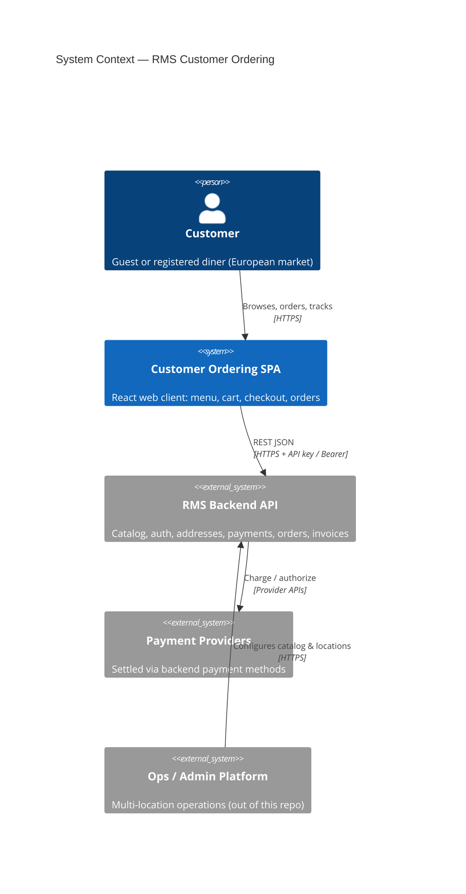

### Context (portable flowchart)

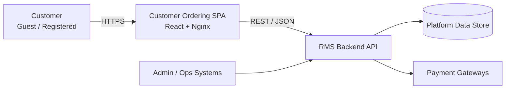

---

## 2. Container Diagram (C4 Level 2)

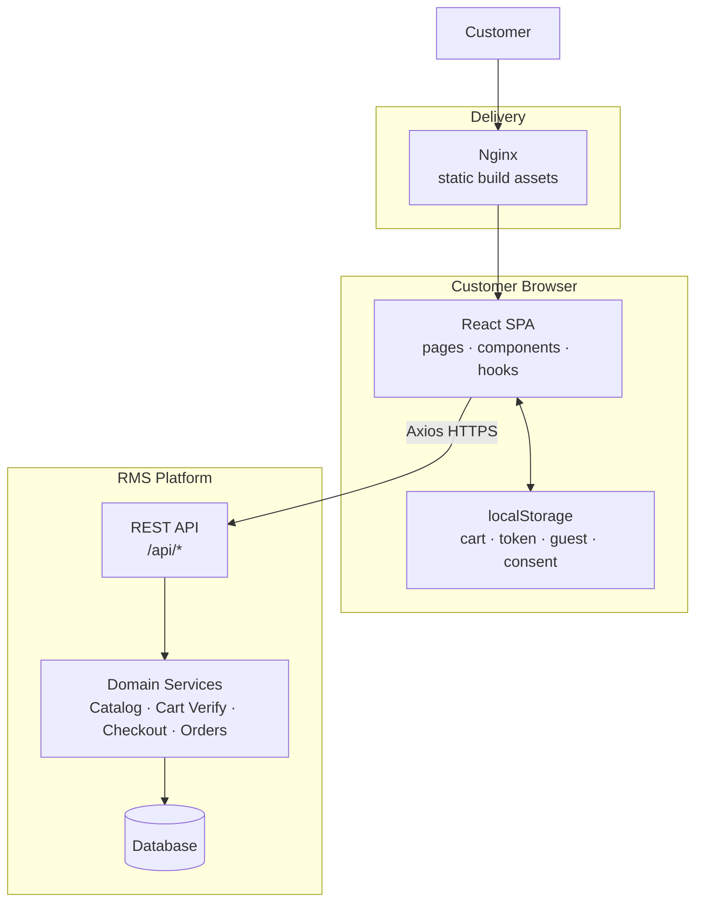

---

## 3. Component Diagram — Frontend Internals

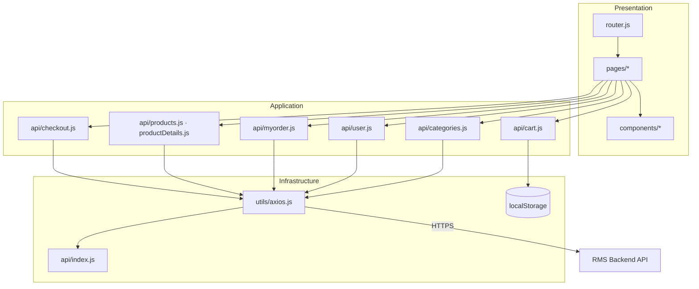

---

## 4. Module Map by Business Domain

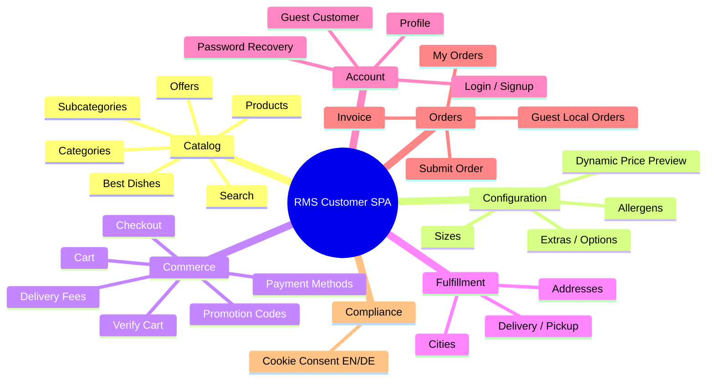

---

## 5. End-to-End Ordering Flow

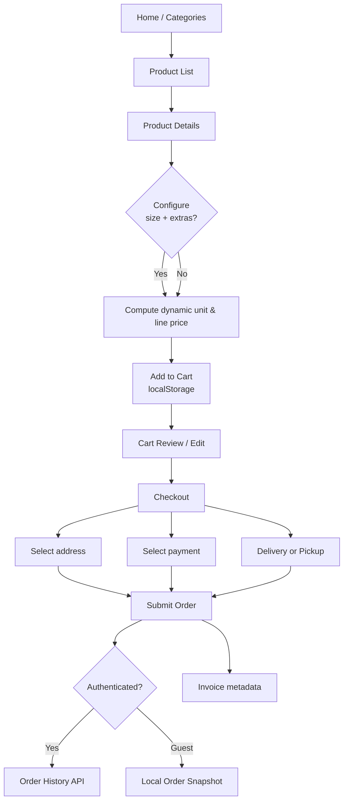

---

## 6. Sequence — Browse, Customize, Add to Cart

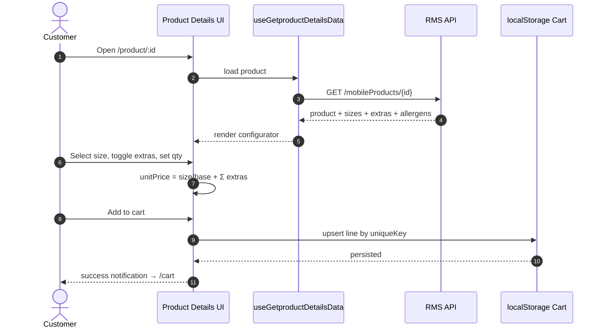

---


## 7. Sequence — Checkout & Invoice

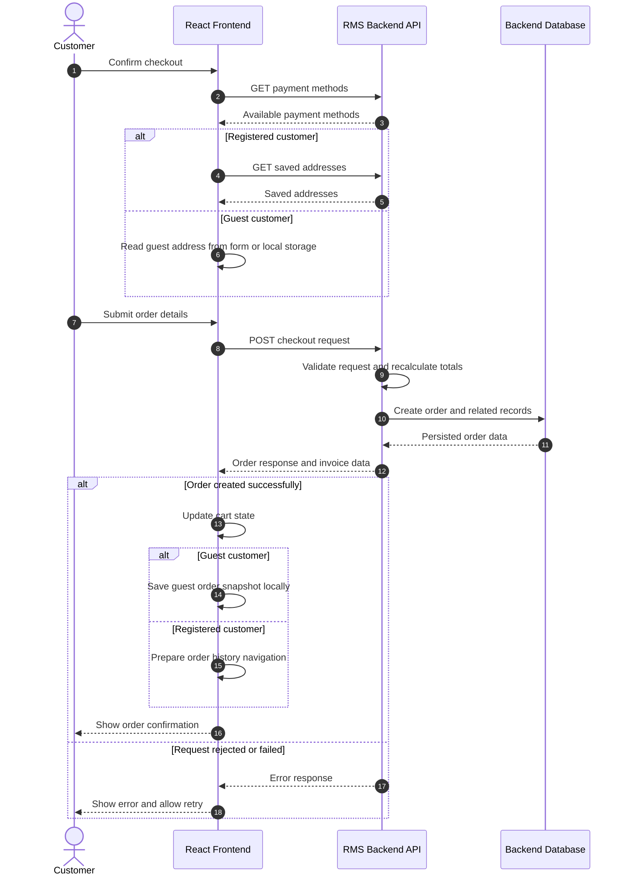


  U->>CO: Select address, payment, delivery/pickup, promo
  CO->>AX: POST checkout-mobile
  Note over AX,API: payload: customer_id, address_id,<br/>payment_method_id, order_items, promotion_code
  API-->>CO: order + invoice
  CO->>LS: clear/update cart; store guest order if needed
  CO-->>U: confirmation / navigate to orders
```

---

## 8. Sequence — Authentication & Session Guard

```mermaid
sequenceDiagram
  autonumber
  actor U as Customer
  participant App as SPA
  participant AX as Axios Interceptor
  participant API as RMS API

  U->>App: Login
  App->>API: POST /login
  API-->>App: token + user.customer.id + role
  App->>App: localStorage token, id; clear isGuest

  U->>App: Request protected resource
  App->>AX: GET with Bearer
  AX->>API: authorized call

  alt 401 Unauthorized
    API-->>AX: 401
    AX-->>App: redirect /login?next=...
  else Success
    API-->>App: payload
  end
```

---

## 9. Dynamic Pricing Breakdown

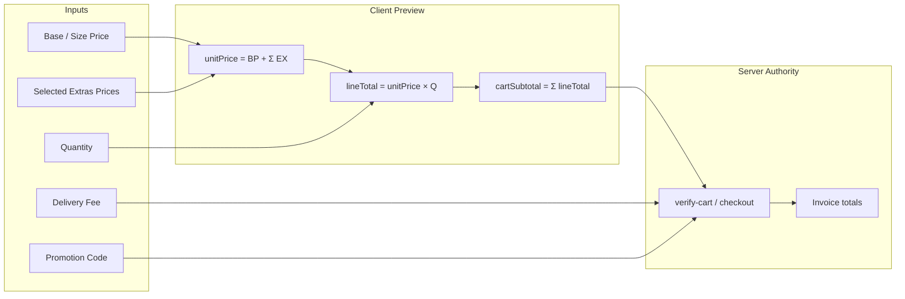

---

## 10. Data Flow — Cart Line Identity

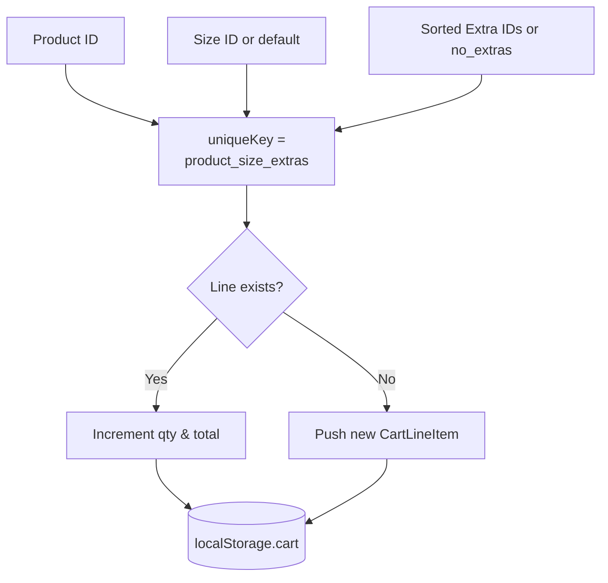

---

## 11. Deployment Topology

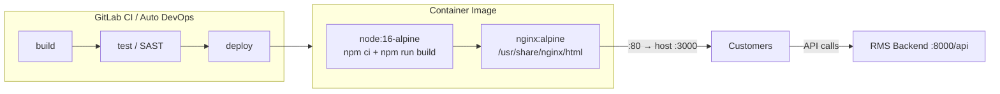

---

## 12. Guest vs Registered Decision

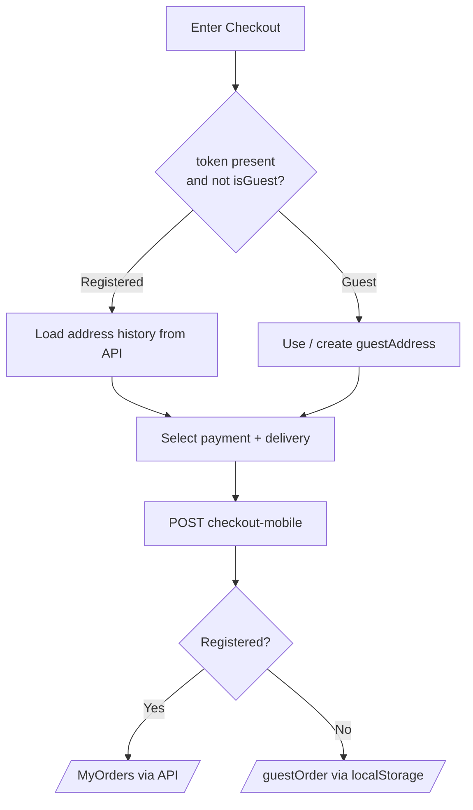

---

## 13. Route Topology

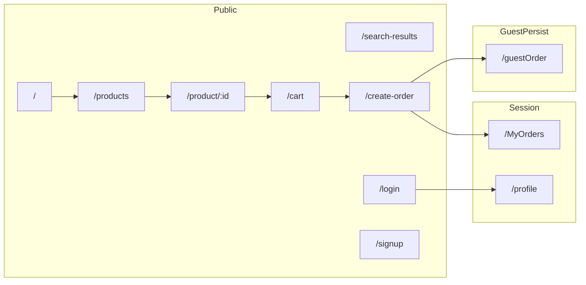

---

## 14. How to Maintain These Diagrams

| When you change… | Update diagram(s) |
|------------------|-------------------|
| New external system | §1 Context |
| New deployable | §2 Containers, §11 Deployment |
| New major module | §3 Components, §4 Mind map |
| Checkout / cart rules | §5–§7, §9–§10 |
| Auth model | §8, §12 |
| Routes | §13 |

Keep diagrams **as code** in this file so architecture reviews stay synchronized with the repository.

---

*End of diagram pack.*
