# Architecture Diagrams
## Restaurant Management System — Customer Ordering Frontend

| Field | Value |
|---|---|
| Document Type | Software Architecture Diagram Pack |
| Notation | Mermaid — C4-inspired context, flowcharts, sequence diagrams, and mind map |
| Architecture Scope | Customer-facing web frontend and its interactions with the RMS backend |
| Standards Reference | C4 Model concepts; ISO/IEC/IEEE 42010-inspired architecture views |
| Companion Documents | [README.md](./README.md) · [ARCHITECTURE.md](./ARCHITECTURE.md) |

> These diagrams describe the customer ordering frontend and its documented interactions with the RMS platform. Backend services, databases, payment integrations, and operational systems are external dependencies unless explicitly identified as part of this repository.
>
> Diagrams should be kept synchronized with the implementation. Architectural recommendations and intended improvements must not be interpreted as evidence that the corresponding behavior has already been implemented or tested.

---

## 1. System Context — C4 Level 1

This view identifies the customer, the frontend application, and the external systems involved in the ordering journey.

### 1.1 C4 Context View

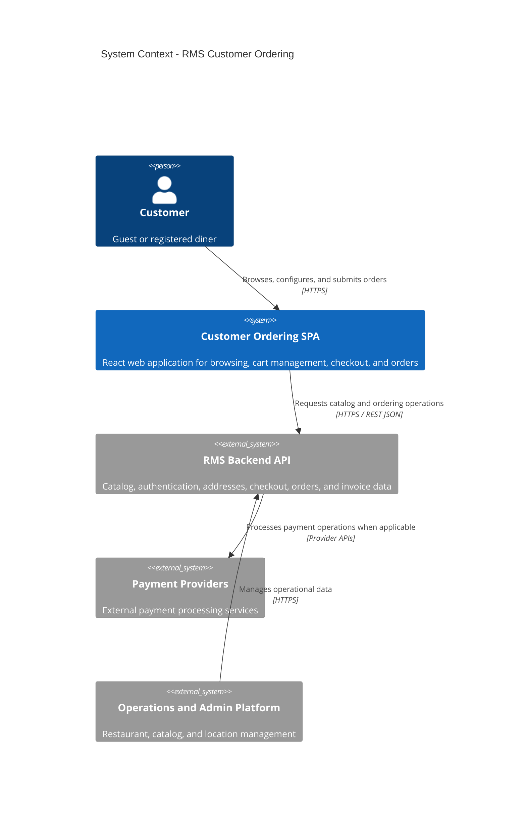

### 1.2 Portable Context View

Use this alternative if the target Mermaid renderer does not support the C4 diagram syntax.

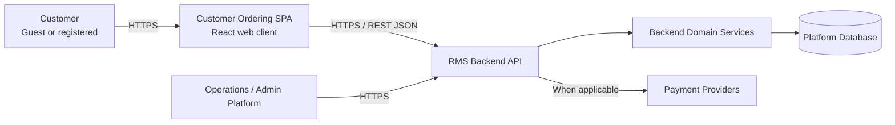

**Architectural boundary:** The browser-facing frontend initiates requests to the backend. Business-critical validation, authoritative order processing, and payment-related decisions belong to the backend and its integrated services.

---

## 2. Container Diagram — C4 Level 2

This view separates the browser runtime, static asset delivery, and backend platform responsibilities.

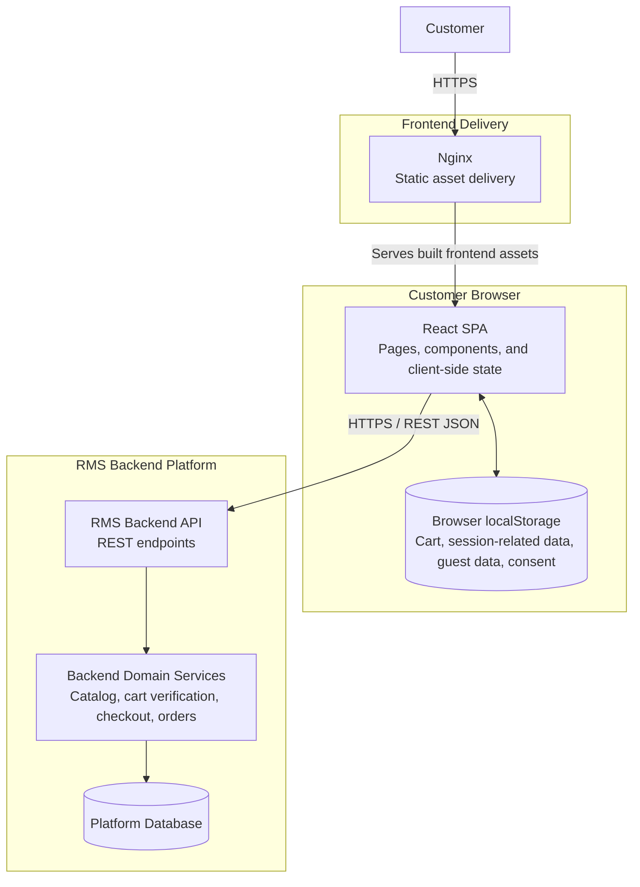

**Responsibilities and boundaries**

- **React SPA:** Renders the user interface, manages client-side interactions, and initiates API requests.
- **Browser localStorage:** Persists selected client-side data. It is not an authoritative source for order, payment, or server-side account state.
- **Nginx:** Serves the built frontend assets in the depicted deployment topology.
- **RMS Backend API:** Exposes the platform operations consumed by the frontend.
- **Backend services and database:** Own server-side business processing and persistent platform records.

The exact relationship between Nginx, the SPA build, and the deployed API must match the actual container and reverse-proxy configuration.

---

## 3. Component Diagram — Frontend Internals

This view illustrates the logical separation between presentation, application-facing API modules, and shared infrastructure.

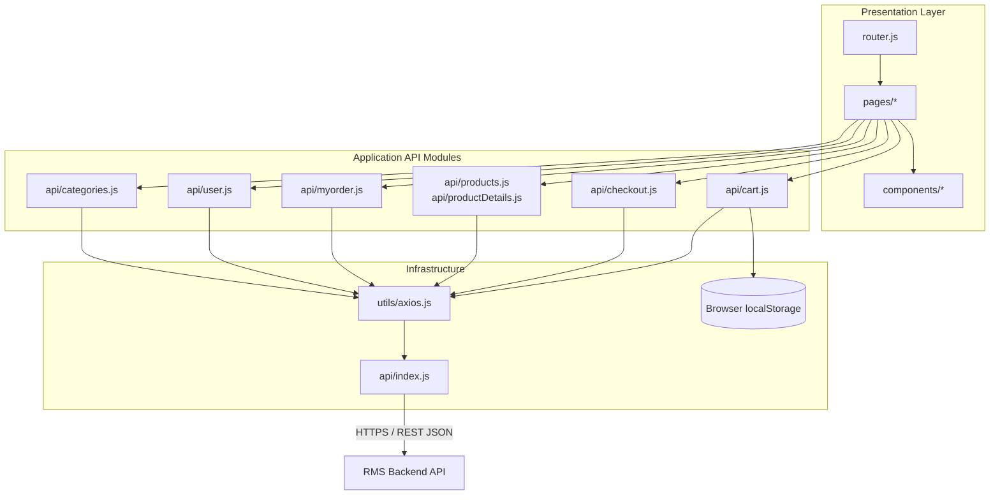

**Interpretation**

- Presentation components handle rendering and user interaction.
- Application-facing modules organize operations by functional area.
- Shared infrastructure centralizes API communication and relevant client-side persistence.
- The diagram is a logical dependency view. Confirm actual imports and call paths against the repository before treating every arrow as a verified code dependency.

---

## 4. Module Map by Business Domain

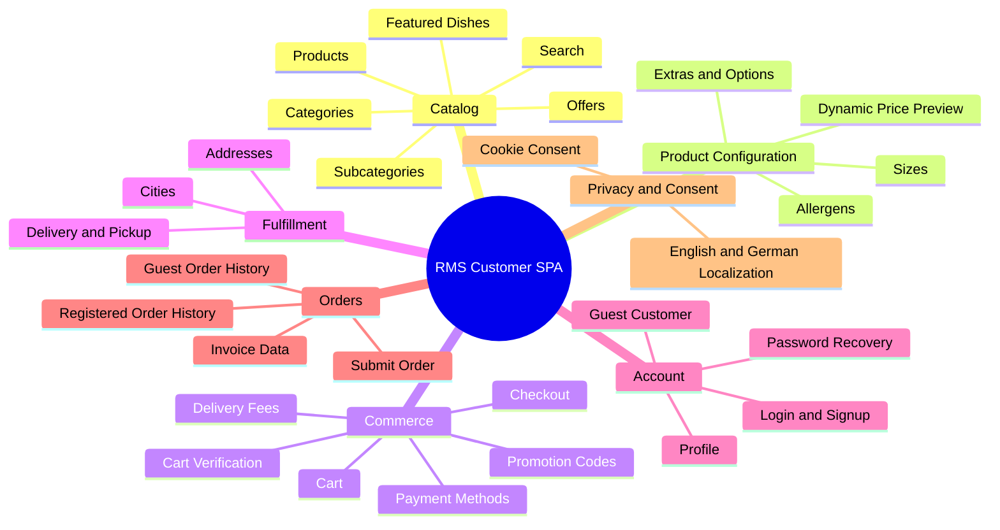

This map groups the documented frontend functionality by business domain. It does not imply that each domain is implemented as an independently deployable module.

---

## 5. End-to-End Ordering Flow

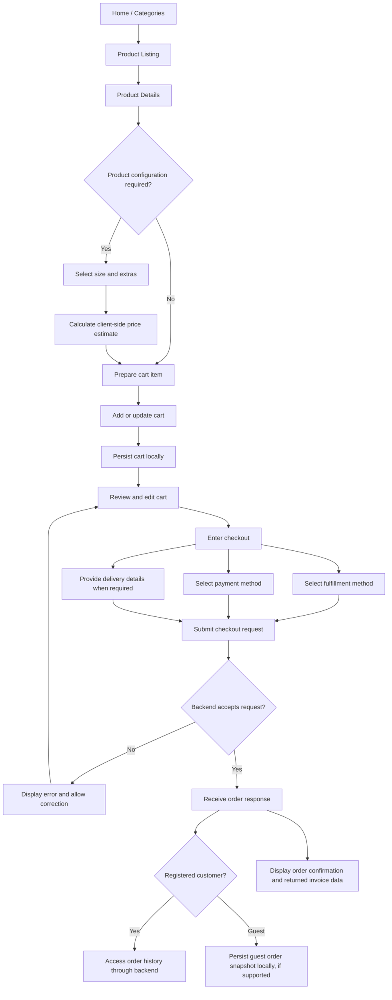

**Important distinction:** A client-side price estimate is not the final authority for order totals. The backend must validate applicable prices, availability, promotions, fees, and order data according to the platform's business rules.

The precise order of validation, persistence, invoice generation, and payment processing must be documented from the actual backend contract.

---

## 6. Sequence — Browse, Customize, Add to Cart

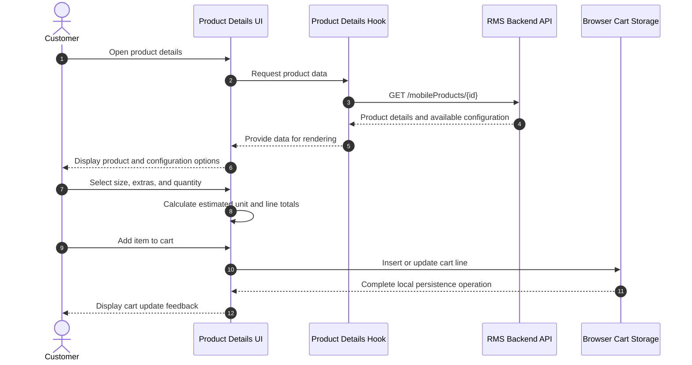

**Notes**

- The product endpoint and response fields shown here must match the API implementation.
- The client may calculate a price preview for usability, but the backend remains authoritative for checkout totals.
- Cart-line merging depends on the application's actual identity rules for products, sizes, extras, and other configurable attributes.

---

## 7. Sequence — Checkout and Invoice

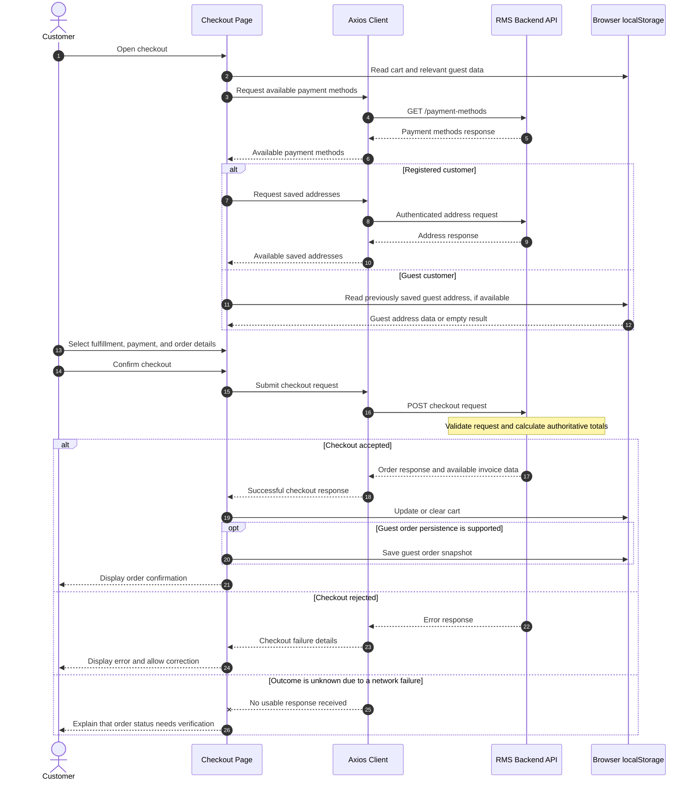

**Interpretation and safeguards**

- The backend response determines whether checkout was accepted.
- Invoice data is shown as part of the returned response only where supported by the actual API contract. This diagram does not assume that an invoice is necessarily finalized at the same moment as order creation.
- A network failure does not prove that the backend failed to create the order. Before retrying, the frontend should use a supported order-status lookup or idempotent submission mechanism where available.
- Cart clearing, guest order persistence, and navigation must follow the actual application behavior and should not discard data needed to recover from an uncertain outcome.
- Payment authorization, payment capture, and payment failure are not expanded into separate flows here because their exact lifecycle is not established by the frontend documentation alone.

---

## 8. Sequence — Authentication and Session Guard

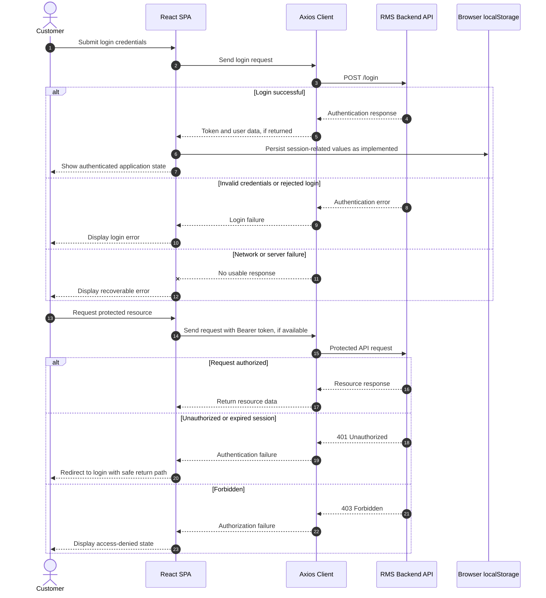

**Security considerations**

- A locally stored token is not proof that the session remains valid; the backend determines whether the request is authorized.
- Return paths must be validated to prevent unsafe external redirects.
- Token storage, expiration, refresh, revocation, and logout behavior must reflect the actual authentication implementation.
- Browser-accessible storage is exposed to JavaScript. If bearer tokens are stored in localStorage, cross-site scripting prevention is especially important.
- Do not assume that `401`, `403`, token refresh, or logout behavior is implemented exactly as illustrated without checking the interceptor and backend contract.

---

## 9. Dynamic Pricing Breakdown

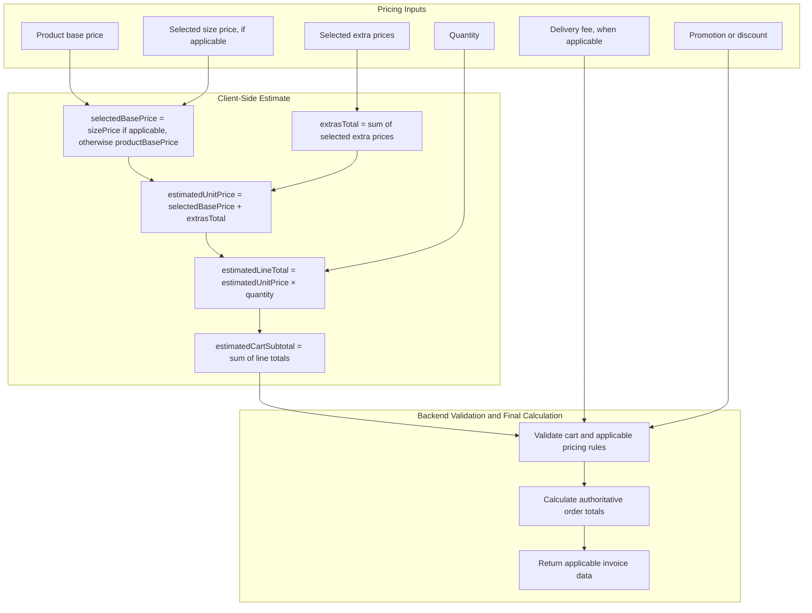

**Pricing rules**

1. Select the applicable base price: the chosen size price when the product configuration requires it; otherwise, the product base price.
2. Add the prices of the selected extras.
3. Multiply the estimated unit price by the requested quantity to calculate the estimated line total.
4. Sum line totals to obtain the estimated cart subtotal.
5. Apply applicable delivery fees, promotions, taxes, rounding, and other business rules on the authoritative calculation path.

The exact treatment of taxes, discounts, rounding, and fee ordering must be specified by the backend's pricing contract. The diagram intentionally does not invent those rules.

---

## 10. Data Flow — Cart Line Identity

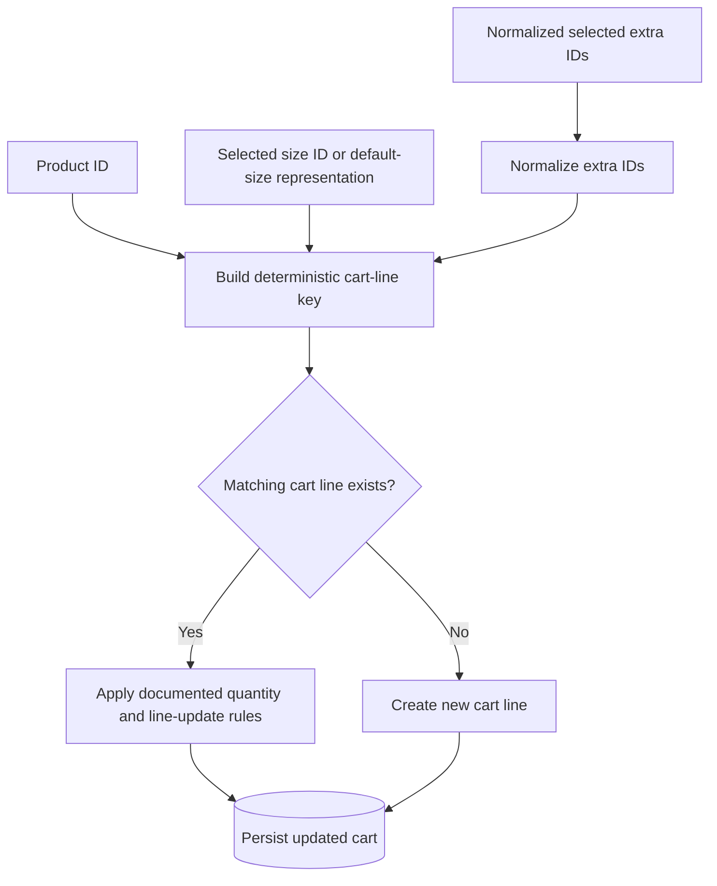

**Identity requirements**

- The key must distinguish configurations that represent different orderable items.
- Selected extra IDs should be normalized deterministically, for example by sorting them when order does not affect meaning.
- The default-size representation must be consistent so that equivalent configurations produce equivalent keys.
- Quantity merging must follow the application's defined behavior.
- If configuration includes other price-affecting attributes, they must be considered in the identity rules when necessary.

The actual `uniqueKey` format should be documented from the cart implementation rather than inferred from the diagram.

---

## 11. Deployment Topology

The following view describes the intended delivery pattern. Replace component labels or connections where the actual CI configuration, Dockerfiles, or hosting environment differ.

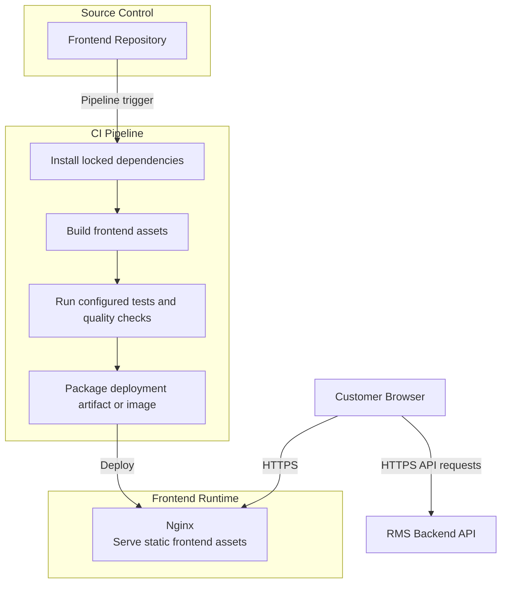

**Deployment requirements**

- Use a supported Node.js LTS release compatible with the repository's dependencies and build tooling.
- Pin runtime and build image versions appropriately for reproducible builds.
- Keep dependency installation aligned with the committed lockfile.
- Configure the production frontend's API base URL and other public build-time settings explicitly.
- Never place private API credentials or server secrets in browser-delivered environment variables or frontend bundles.
- Confirm whether the actual pipeline uses GitLab CI, Auto DevOps, Docker, or another deployment mechanism before describing any of them as verified infrastructure.
- Document HTTPS termination, API routing, environment configuration, health checks, rollback, and artifact promotion where applicable.

The diagram intentionally omits specific host ports and internal backend ports because those values must be verified against the actual deployment configuration.

---

## 12. Guest vs. Registered Customer Decision

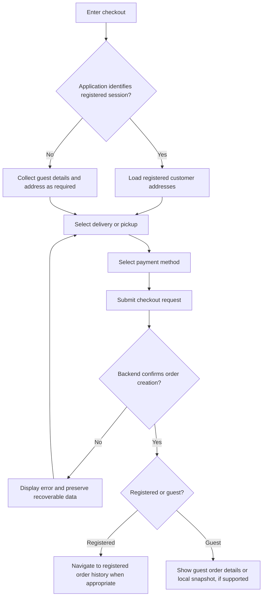

**Decision rules**

- Session classification must follow the application's actual authentication state and guest-mode logic.
- Token presence alone should not be treated as conclusive evidence of a valid authenticated session.
- Registered order history should use the backend's authorized order data.
- Locally persisted guest order data is a convenience, not a guaranteed or authoritative order record.
- Navigation should happen only after the checkout response establishes the appropriate outcome.

---

## 13. Route Topology

This view groups the documented routes by their primary purpose. Route names and access controls must be verified against the router configuration.

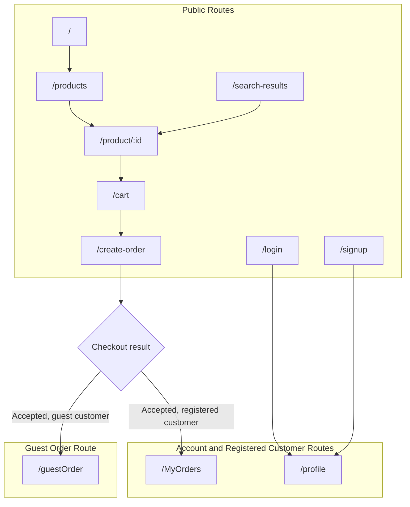

**Route interpretation**

- Route grouping does not itself establish whether a route is public, protected, or conditionally accessible.
- Login redirects and protected-route guards should preserve only validated internal return paths.
- The checkout result determines the appropriate post-checkout destination; the diagram does not imply that both order destinations are visited.
- Confirm route casing, route parameters, fallback routes, and redirect behavior against the actual application router.

---

## 14. Diagram Maintenance and Change Control

Update the relevant diagrams whenever implementation changes affect the system's structure, responsibilities, or runtime behavior.

| Change | Diagrams to Review |
|---|---|
| New external system or integration | §1 System Context |
| New runtime container or deployment boundary | §2 Container Diagram, §11 Deployment |
| New frontend module or dependency | §3 Component Diagram, §4 Module Map |
| Changes to the customer ordering journey | §5 End-to-End Ordering Flow |
| Product configuration or cart behavior | §4 Module Map, §6 Browse Sequence, §10 Cart Identity |
| Checkout, invoice, or payment contract | §5 End-to-End Flow, §7 Checkout Sequence, §9 Pricing |
| Authentication or session handling | §8 Authentication Sequence, §12 Guest vs. Registered |
| Pricing, promotions, taxes, or fees | §5 End-to-End Flow, §7 Checkout Sequence, §9 Pricing |
| Route additions or access-control changes | §8 Authentication Sequence, §12 Guest vs. Registered, §13 Route Topology |
| CI, Docker, hosting, or runtime changes | §2 Container Diagram, §11 Deployment |

### Review Checklist

Before merging changes to this document:

- [ ] Validate Mermaid syntax using the target GitHub renderer.
- [ ] Confirm route names and endpoint paths against the source code.
- [ ] Confirm sequence participants and message directions.
- [ ] Ensure frontend calculations are distinguished from backend-authoritative decisions.
- [ ] Verify error, retry, and uncertain-outcome behavior against the implementation.
- [ ] Confirm deployment diagrams match the actual CI and runtime configuration.
- [ ] Remove obsolete components, endpoints, and flows.
- [ ] Ensure all companion documentation remains consistent.

### Architecture Documentation Note

This document uses C4-inspired context and container views, component-level dependency diagrams, and UML-style sequence diagrams. Its references to C4 and ISO/IEC/IEEE 42010 describe the documentation approach; they do not, by themselves, establish formal standards compliance.

---

*End of Architecture Diagram Pack.*
